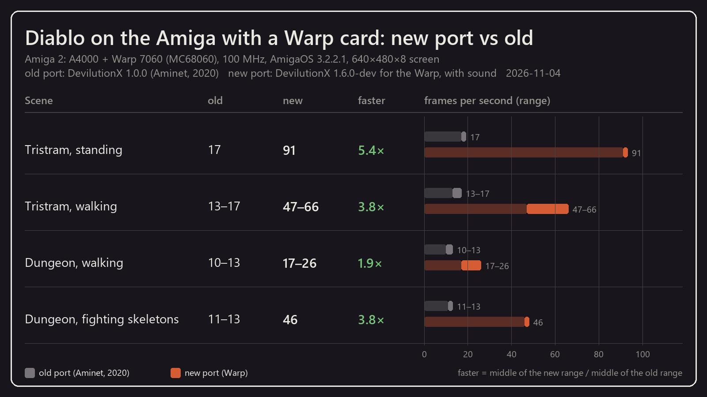

# DiabloWarp: Diablo for the Amiga with a Warp card

**Diablo** (Blizzard, 1996) on the Amiga: [DevilutionX](https://github.com/diasurgical/devilutionX),
the open source Diablo engine (1.6.0-dev), ported to AmigaOS 3 with its own native SDL2 layer.

**This is a special port for the Amiga 500 / 1200 / 3000 / 4000 with a Warp accelerator card:
Warp 560, Warp 1240, Warp 1260, Warp 1260 Extreme or Warp 7060.** It was ported and tested on
these machines (an A1200 with a Warp 1260 Extreme and an A4000 with a Warp 7060, both 68060 at
100 MHz), and it is tuned for them: the picture is put together in Fast RAM, only what changed
travels to the card, and the card's blitter scrolls the view. That fast graphics card is what
makes the frame rates below possible. Other 68040/68060 Amigas with a Picasso96 card run it as
well, but slower.

- the whole single player game of Diablo with DevilutionX's improvements (item labels, gold
  pickup, monster health bars and more, in the game settings)
- 640x480 on an 8-bit Picasso96 screen; on a Warp 7060 at 100 MHz (frames per second):
  Tristram standing 91, walking 47-66; dungeon walking 17-26, fighting 46
- sound on Paula: effects, music and speech (stereo, 22 kHz); videos twice the size
- English, Polish and German (and the other DevilutionX languages); Polish speech with the
  DevilutionX voice pack, converted for this port
- "Light Steps" option for faster walking in the dungeon
- Workbench icon with Tool Types, F10 bug reports, the release number in the main menu

## Play it

The ready-to-unpack release is in [`releases/amiga`](releases/amiga):
`DiabloWarp-<version>.zip` (also unpacked next to it; on the Amiga:
`UnZip DiabloWarp-<version>.zip -d Work:Games`). Read
[`DiabloWarp_en.txt`](releases/amiga/DiabloWarp/doc/DiabloWarp_en.txt) (Polish:
[`DiabloWarp.txt`](releases/amiga/DiabloWarp/doc/DiabloWarp.txt)) and the release history
[`DiabloWarp_release_en.txt`](releases/amiga/DiabloWarp/doc/DiabloWarp_release_en.txt).

**Requirements:** an Amiga with a Warp card (68060 or 68040), about 64 MB of free Fast RAM
(the game uses about 40 MB), AmigaOS 3.2 (tested 3.2.2.1), a Picasso96 card with an 8-bit
640x480 mode, Paula sound.

**Settings:** language, frame counter, Light Steps, volume and the rest are chosen in the game
and kept in `save/diablo.ini`. Tool Types of the devilutionx icon (the same words work as Shell
arguments): `DATADIR=`, `SAVEDIR=`, `LANGUAGE=pl|en|de|...`, `SHOWFPS=YES|NO`, `SKIPINTRO`,
`NOSOUND`.

### The game data is not included

The graphics, sounds, music and levels are in `diabdat.mpq` of the original **Diablo**
(c) Blizzard Entertainment. It is not in this repository and we do not link to downloads: copy
it from **your own copy** (the CD or the GOG version) into `DiabloWarp/data`.

### Polish speech

DevilutionX has a Polish voice pack recorded by professional actors (WiAParker): `pl.mpq` from
the [devilutionx-assets](https://github.com/diasurgical/devilutionx-assets) releases. Its speech
is MP3; this port plays it after a one-time conversion on a PC with
`tools/voicepack/convert.sh` (ffmpeg and Docker). Copy the result to `DiabloWarp/data`.

## Build

- the upstream DevilutionX sources (not in this repository) in `upstream/devilutionX`, commit
  `b325996a89c59eb0a680406b7ede3747011b9e08` (31 October 2026)
- `tools/build.sh` – in Docker (`amigadev/crosstools:m68k-amigaos-gcc10`): a clean copy of
  upstream + `port/apply_port.py` (our changes) + `port/overlay` + the native SDL2 subset
  `port/sdl` → `build/amiga/devilutionx`
- `tools/make_release.sh` – `releases/amiga` and the ZIP archive (`tools/make_zip.py`, Amiga
  protection bits kept)
- the release number: `port/VERSION`

How it was done, the decisions and the measurements: [`docs/PORTING.md`](docs/PORTING.md) (Polish).

## Licence

DevilutionX is under the [Sustainable Use License](LICENSE.md): free for non-commercial use and
distribution. **This is a modified version of DevilutionX**: ported to AmigaOS 3 for the Warp
cards (own SDL2 layer, renderer, sound and Amiga additions). Diablo is a trademark of Blizzard
Entertainment; this project only contains the engine, not the game.
